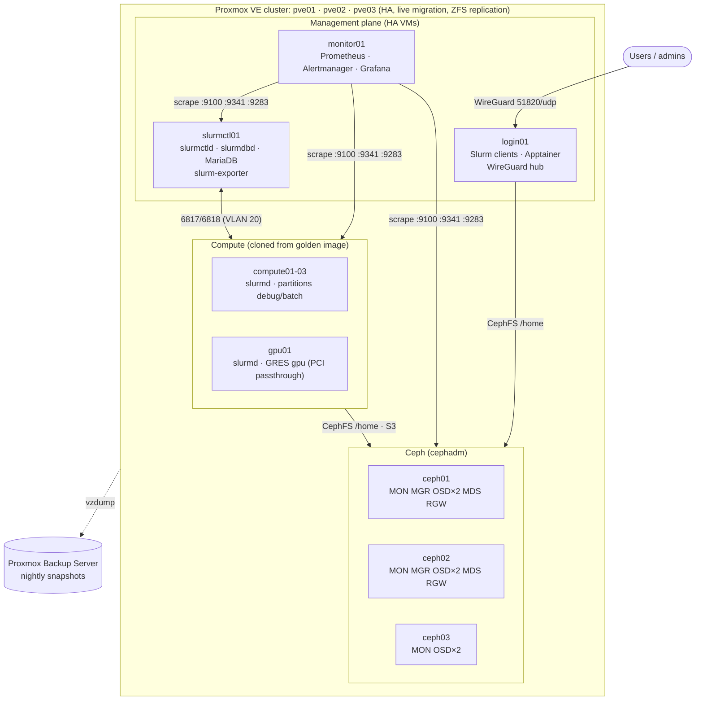

# HPC Mini-Cluster Lab: Slurm, Ceph & Proxmox, Automated with Ansible

[](../../actions/workflows/lint.yml)

This is a small HPC cluster built the way a real one is run. Everything is defined as code: the hypervisors, the golden image, the VMs, the storage, the scheduler, monitoring and the firewall are all Ansible roles in this repo. A CI pipeline lints every change and rolls it out in stages.

**Stack:** Proxmox VE · Proxmox Backup Server · Rocky Linux 9 · cloud-init · Ansible · Slurm (slurmctld / slurmdbd / slurmd) · Ceph (cephadm: RBD, CephFS, RGW/S3) · Apptainer · Prometheus · Alertmanager · Grafana · nftables · WireGuard · GitLab CI / GitHub Actions

---

## Architecture



| VLAN | Network | Purpose |
|---|---|---|
| 10 | 10.10.10.0/24 | Management, SSH, Prometheus scraping, cephadm |
| 20 | 10.10.20.0/24 | Slurm control and MPI traffic |
| 30 | 10.10.30.0/24 | Ceph public network (clients, MON, RGW) on the **LACP bond** |
| 31 | 10.10.31.0/24 | Ceph cluster network (OSD replication) on the **LACP bond** |
| 50 | 10.10.50.0/24 | Corosync (Proxmox cluster heartbeat) |
| WireGuard | 10.200.0.0/24 | Remote access, NAT'd onto VLANs 10 and 20 only |

More detail: [docs/architecture.md](docs/architecture.md) · [docs/network.md](docs/network.md)

---

## What is implemented

| Area | Where | Highlights |
|---|---|---|
| **Proxmox VE cluster** | `roles/proxmox_network`, `roles/proxmox_cluster` | 802.3ad bond plus a VLAN-aware bridge, corosync on its own VLAN, `pvecm` cluster formation one node at a time, an HA group for the management plane, ZFS storage replication so HA failover works, a PBS datastore with a nightly backup job and retention |
| **Golden image** | `roles/proxmox_template` | Rocky 9 GenericCloud image customised with `virt-customize` (qemu-guest-agent, machine-id reset), converted to a cloud-init template |
| **VM provisioning** | `roles/proxmox_vms` | API-driven full clones, CPU/RAM per group, VLAN-tagged NICs plus cloud-init IPs generated from inventory, OSD disks for Ceph VMs, GPU PCI passthrough |
| **Ceph** | `roles/ceph_cephadm`, `roles/ceph_client` | `cephadm bootstrap` plus a declarative service spec (3 MON, 2 MGR, 6 OSDs, 2 MDS, 2 RGW), a size=3/min_size=2 RBD pool, a CephFS volume mounted as shared `/home`, an RGW S3 user and the mgr Prometheus module |
| **Slurm** | `roles/munge`, `roles/slurm_*`, `roles/slurmdbd` | `cons_tres`, cgroup v2 isolation, partitions `debug`/`batch`/`gpu`, multifactor priority with **FAIR_TREE fair-share**, an account hierarchy and QoS in slurmdbd, **GRES GPU** with `gres.conf`, PMIx for multi-node MPI. The node list in `slurm.conf` is generated from inventory |
| **Containers** | `roles/apptainer` | Apptainer with a node-local cache. SIF images live on CephFS so every node can use them |
| **Monitoring** | `roles/node_exporter`, `roles/slurm_exporter`, `roles/monitoring_stack` | node_exporter on every node, Slurm exporter built from a pinned tag, Prometheus, Alertmanager and Grafana as Podman containers under systemd, alert rules (node, Slurm, Ceph), provisioned dashboards |
| **Security** | `roles/nftables`, `roles/wireguard`, `roles/common` | Default-deny nftables, with ports opened per role **and per source VLAN**. WireGuard hub with NAT, SSH hardening, SELinux enforcing, secrets in Ansible Vault |
| **CI/CD** | `.gitlab-ci.yml`, `.github/workflows/lint.yml` | yamllint, ansible-lint (production profile), syntax check and shellcheck. Then `--check --diff`, then **canary → full** manual stages, then `verify.yml` |
| **Day-2 ops** | `playbooks/rolling-update.yml` | Drain-aware rolling patching (`serial: [1, 50%, 100%]`, `max_fail_percentage: 0`): drain, wait for jobs, update, reboot, health check, resume |

---

## Repository layout

```
ansible.cfg  requirements.yml  Makefile
inventories/lab/
  hosts.yml                 # every host, IP, VMID and group (single source of truth)
  group_vars/all/           # networks, Slurm/Ceph globals, users, vault indirection
  group_vars/{proxmox,ceph,compute,compute_gpu,mgmt_plane}.yml
playbooks/
  proxmox.yml golden-image.yml provision-vms.yml        # bring-up, steps 1-3
  site.yml = common + security + ceph + slurm + monitoring   # step 4
  rolling-update.yml verify.yml
roles/                      # 20 roles, see table above
tests/slurm-jobs/           # MPI, GPU/GRES, Apptainer, fair-share, accounting
tests/apptainer/            # GPU container definition
scripts/                    # Ceph OSD failure drill, PBS restore test, S3 and HA tests
docs/                       # architecture, network, runbooks, validation log
```

---

## Bring-up

Prerequisites: 3 hosts with Proxmox VE 8 installed (plus an optional PBS host), a managed switch with LACP and VLANs, and a control machine with Ansible 2.15 or newer.

```bash
make deps                                         # install collections
cp inventories/lab/group_vars/all/vault.yml.example inventories/lab/group_vars/all/vault.yml
$EDITOR inventories/lab/group_vars/all/vault.yml  # set passwords and the munge key
ansible-vault encrypt inventories/lab/group_vars/all/vault.yml
echo 'your-vault-pass' > .vault_pass && chmod 600 .vault_pass

make proxmox      # 1. bond, VLAN bridges, cluster, HA group, replication, PBS
make template     # 2. golden Rocky 9 cloud-init template
make vms          # 3. clone + network + start all VMs
make site         # 4. baseline, nftables/WireGuard, Ceph, Slurm, monitoring
make verify       # smoke tests: ceph health, /home on CephFS, srun -N2, Prometheus targets
```

Adapt `inventories/lab/hosts.yml` (IPs, NIC names in `group_vars/proxmox.yml`, GPU PCI address) to your hardware. Every role is idempotent, so you can re-run `make site` at any time.

### Try it out

```bash
ssh alice@login01
cd tests/slurm-jobs
sbatch 01-hello-mpi.sbatch      # 12 ranks over 3 nodes, MPI_Allreduce check
sbatch 02-gpu-gres.sbatch       # must see exactly one GPU
sbatch 03-apptainer.sbatch      # OCI image -> SIF on CephFS, run on 2 nodes
sudo ./04-fairshare-demo.sh     # watch sshare/sprio diverge between accounts
```

Grafana: `http://monitor01:3000` (over WireGuard) → folder **HPC Lab**.

---

## Resilience testing

| Test | How | Runbook |
|---|---|---|
| Ceph OSD failure and recovery | `scripts/ceph-osd-failure-drill.sh osd.0` stops an OSD, proves I/O continues while degraded, times the backfill, and verifies sha256 sums of 200 objects | [docs/runbooks/ceph-osd-failure.md](docs/runbooks/ceph-osd-failure.md) |
| Backup and restore | `scripts/backup-restore-test.sh 201` restores the latest PBS backup to a new VMID with NICs link-down, waits for the guest agent, reports the RTO, then cleans up | [docs/runbooks/backup-restore.md](docs/runbooks/backup-restore.md) |
| Live migration and HA | `scripts/proxmox-ha-test.sh 201 pve02`, then power off a node and watch relocation | [docs/runbooks/proxmox-ha.md](docs/runbooks/proxmox-ha.md) |
| S3 object storage | `scripts/s3-smoke-test.sh` does a 10 MiB round-trip through RGW | — |
| Rolling node updates | `make rolling`, which drains nodes, patches them and resumes them, one batch at a time | [docs/runbooks/slurm-operations.md](docs/runbooks/slurm-operations.md) |

Record your measured results in [docs/validation.md](docs/validation.md).

---

## License

MIT
